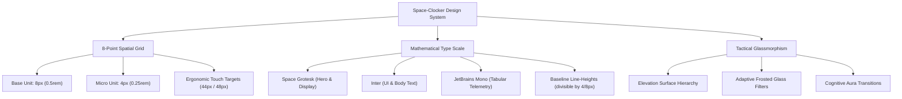

# Space-Clocker Design System: 8pt Grid, Spacing & Typography

> **Status:** Active & Implemented  
> **Aesthetic Identity:** Tactical Sci-Fi Glassmorphism & High-Fidelity Astro-Productivity  
> **Specification Document:** [design-system.md](file:///home/charlie/Games/Projects/suites/Space-Clocker/docs/design-system.md)  
> **Global CSS Tokens:** [src/index.css](file:///home/charlie/Games/Projects/suites/Space-Clocker/src/index.css#L1-L200)

---

## 1. Core Architectural Pillars



---

## 2. The 8-Point Spatial Grid & Spacing Tokens

All dimensions, margins, padding, and gaps are locked to a strict base-8 scale, with a 4px (0.25rem) half-grid reserved strictly for micro-elements (inline badges, status tags, icon-to-label gaps).

| Token | Pixels | Rem Value | Tailwind Class | Semantic Application |
| :--- | :--- | :--- | :--- | :--- |
| **`space-0.5`** | `2px` | `0.125rem` | `p-0.5`, `gap-0.5` | Hairline offsets, indicator dots, micro-borders |
| **`space-1`** | `4px` | `0.25rem` | `p-1`, `gap-1`, `m-1` | **0.5x Micro Grid:** Inline badge padding, icon-text gap, compact pill tags |
| **`space-1.5`** | `6px` | `0.375rem` | `p-1.5`, `gap-1.5` | Specialized pill tag vertical padding, tight status pills |
| **`space-2`** | `8px` | `0.5rem` | `p-2`, `gap-2`, `m-2` | **1x Base Unit:** Tight button padding, dense list item gap, icon-only button padding |
| **`space-3`** | `12px` | `0.75rem` | `p-3`, `gap-3`, `m-3` | **1.5x Unit:** Form input horizontal padding, compact card padding, small modal headers |
| **`space-4`** | `16px` | `1.0rem` | `p-4`, `gap-4`, `m-4` | **2x Unit (Standard):** Mobile card padding, standard layout gap, default card body padding |
| **`space-5`** | `20px` | `1.25rem` | `p-5`, `gap-5`, `m-5` | Intermediate card padding, nested drawer gutters |
| **`space-6`** | `24px` | `1.5rem` | `p-6`, `gap-6`, `m-6` | **3x Unit (Medium):** Desktop card padding, section gap, modal dialog padding |
| **`space-8`** | `32px` | `2.0rem` | `p-8`, `gap-8`, `m-8` | **4x Unit (Large):** View container margins, hero card padding, major section divisions |
| **`space-10`** | `40px` | `2.5rem` | `p-10`, `gap-10` | Section dividers, large modal gutters |
| **`space-12`** | `48px` | `3.0rem` | `p-12`, `gap-12` | Major dashboard grid separation, empty state breathing room |
| **`space-16`** | `64px` | `4.0rem` | `p-16`, `gap-16` | Screen top hero spacing, major modality transitions |
| **`space-20`** | `80px` | `5.0rem` | `p-20`, `gap-20` | Panoramic canvas margins, deep space padding |

### Component Dimension Hierarchy

- **Micro / Pill Badge:** `h-6` (24px), `px-2` (8px), font-size 11px
- **Compact Button:** `h-8` (32px), `px-3` (12px), font-size 12px
- **Standard Button & Input:** `h-10` (40px), `px-4` (16px), font-size 14px
- **Primary CTA & Search:** `h-12` (48px), `px-6` (24px), font-size 16px
- **Touch Target Boundary:** Guaranteed `min-h-[44px] min-w-[44px]` (or standard `min-h-[48px] min-w-[48px]` via `.touch-target`)
- **Top Navigation Bar:** `h-16` (64px)

---

## 3. Typographic System & Harmonious Baseline Rhythm

### 3.1 Font Stack

1. **`--font-sans` (`Inter`):** Primary UI, body copy, descriptions, form labels.
2. **`--font-display` (`Space Grotesk`):** Screen titles, hero headlines, modal headings, milestone titles.
3. **`--font-mono` (`JetBrains Mono`):** Telemetry readouts, timecodes, XP counters, timestamps, coordinates, system codes (features `tnum` tabular numbers and slashed zero).

### 3.2 Harmonious Type Hierarchy Table

> [!IMPORTANT]
> Every single font size is mathematically paired with a line-height that is an exact multiple of **4px or 8px** (12, 16, 20, 24, 28, 32, 36, 40, 44px) to preserve continuous baseline rhythm.

| Typographic Role | Utility Class | Font Family | Size (px / rem) | Line Height (px / rem) | Weight & Tracking | Semantic Usage |
| :--- | :--- | :--- | :--- | :--- | :--- | :--- |
| **Display / Hero** | `.type-display` | Space Grotesk | `36px` / `2.25rem` | `44px` / `2.75rem` *(÷4)* | Bold (700), `-0.025em` | Hero titles, major level-up banners |
| **Title 1 (H1)** | `.type-title-1` | Space Grotesk | `28px` / `1.75rem` | `36px` / `2.25rem` *(÷4)* | Bold (700), `-0.02em` | Main view headers (Orbit, Nebula, Matrix) |
| **Title 2 (H2)** | `.type-title-2` | Space Grotesk | `22px` / `1.375rem` | `28px` / `1.75rem` *(÷4)* | SemiBold (600), `-0.015em` | Major section headers, modal headers |
| **Title 3 (H3)** | `.type-title-3` | Space Grotesk | `18px` / `1.125rem` | `24px` / `1.5rem` *(÷8)* | SemiBold (600), `-0.01em` | Card titles, milestone names, sub-headers |
| **Headline (H4)** | `.type-headline` | Inter | `16px` / `1.0rem` | `24px` / `1.5rem` *(÷8)* | SemiBold (600), `0` | Task card titles, list item titles |
| **Body Large** | `.type-body-lg` | Inter | `16px` / `1.0rem` | `24px` / `1.5rem` *(÷8)* | Regular (400), `0` | Introductory paragraphs, guide bodies |
| **Body (Default)** | `.type-body` | Inter | `14px` / `0.875rem` | `20px` / `1.25rem` *(÷4)* | Regular (400), `0` | Standard UI copy, inputs, table values |
| **Body Small** | `.type-body-sm` | Inter | `12px` / `0.75rem` | `16px` / `1.0rem` *(÷8)* | Medium (500), `+0.01em` | Helper text, secondary descriptions |
| **Caption / Overline** | `.type-overline` | Inter | `11px` / `0.6875rem` | `16px` / `1.0rem` *(÷8)* | SemiBold (600), `+0.06em` UP | Category tags, column overlines, pills |
| **Telemetry Micro** | `.type-telemetry-micro` | JetBrains Mono | `10px` / `0.625rem` | `12px` / `0.75rem` *(÷4)* | Medium (500), `tabular-nums` | Micro coordinates, status flags |
| **Telemetry Base** | `.type-telemetry-base` | JetBrains Mono | `14px` / `0.875rem` | `20px` / `1.25rem` *(÷4)* | SemiBold (600), `tabular-nums` | Time pickers, daily task clock (`09:00 - 10:30`) |
| **Telemetry Large** | `.type-telemetry-lg` | JetBrains Mono | `24px` / `1.5rem` | `32px` / `2.0rem` *(÷8)* | Bold (700), `tabular-nums` | Progress stats (`87%`), Level (`LVL 08`) |
| **Telemetry Hero** | `.type-telemetry-hero` | JetBrains Mono | `36px` / `2.25rem` | `40px` / `2.5rem` *(÷8)* | Bold (700), `tabular-nums` | Stopwatch timers, decay countdowns |

---

## 4. Surfaces, Glassmorphism & Elevation

```
Surface Lowest   (#0b0e14) -> Deep space canvas background
Surface Low      (#191c22) -> Sunken wells, inactive rails
Surface Base     (#1d2026) -> Standard container cards (.glass-panel-subtle)
Surface High     (#272a31) -> Active cards, interactive panels (.glass-panel)
Surface Highest  (#32353c) -> Modals, dropdown sheets (.glass-panel-elevated)
```

- **`glass-panel`**: `backdrop-blur(20px)`, `bg-[#32353c]/60`, `border-[#3a494b]/40`.
- **`glass-panel-subtle`**: `backdrop-blur(12px)`, `bg-[#1d2026]/50`, `border-[#3a494b]/25`.
- **`glass-panel-elevated`**: `backdrop-blur(24px)`, `bg-[#32353c]/80`, `border-[#00f2ff]/20`, `shadow-2xl`.

---

## 5. Implementation & Usage Examples

### Task Card Example adhering to 8pt Grid & Typography
```tsx
<article className="glass-panel card-standard flex flex-col gap-3">
  {/* Header: Title + Telemetry */}
  <div className="flex items-center justify-between gap-2">
    <h3 className="type-headline text-on-surface">Deploy Terraform Infrastructure</h3>
    <span className="type-telemetry-base text-primary-container">09:00 - 10:30</span>
  </div>

  {/* Description */}
  <p className="type-body text-on-surface-variant">
    Deconstruct VPC peering and automate security group egress controls.
  </p>

  {/* Footer: Tags & Action */}
  <div className="flex items-center justify-between pt-2 border-t border-outline-variant/30">
    <span className="type-overline bg-surface-high px-2 py-0.5 rounded text-secondary">
      AWS SPECIALIST
    </span>
    <button className="touch-target-compact h-8 px-3 rounded-lg bg-primary-container text-on-primary-container font-medium text-xs">
      Initiate Focus
    </button>
  </div>
</article>
```
